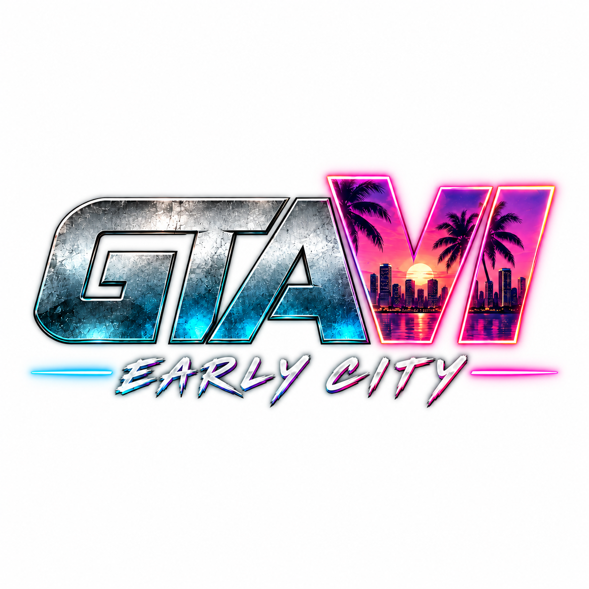

# GTAVI - Early City

<div align="center">
  
</div>


**Independent playable 2D open-world browser prototype · Alpha v0.3.0**

> This is an original fan-made game experiment. It is **not** GTA VI, is **not** produced by Rockstar Games, contains **no leaked CyberLeak/Cyberleek files**, and any AI-generated visualization must be labeled concept footage. The playable build is a top-down Canvas game, not a realistic third-person 3D game.

## Quick start

**Option A, simplest:** open `index.html` in a modern desktop browser. If local module-loading restrictions affect the page, use Option B.

**Option B, development server:**

```bash
npm install
npm run dev
```

Open the URL printed by Vite. To generate a distribution build:

```bash
npm run check
npm test
npm run build
npm run preview
```

`npm install` requires an internet connection and Node.js 20+ for the tooling. The runtime game itself does not require a backend.

## What can you actually do?

- Explore a fixed 3600 × 2880 top-down city of roads, buildings and parks.
- Walk, sprint, control stamina, and use a following camera.
- Enter cars and drive with arcade handling, collisions and vehicle damage.
- See 38 simple traffic cars and up to 75 wandering pedestrians.
- Complete **nine** waypoint-based missions and earn cash.
- Visit one of two garages and press G to repair a damaged vehicle for in-game money.
- View wanted stars as a basic heat indicator, HUD gauges, minimap and city map.
- Experience a simulated day/night lighting overlay.
- Manually save and load progress using local browser storage.

## Keyboard controls

| Key | Action |
|---|---|
| W / A / S / D or arrows | Walk / accelerate / brake / steer |
| Shift | Sprint on foot |
| E | Enter or exit a nearby vehicle |
| G | Repair car at garage (cost depends on damage) |
| M | Full-screen map |
| H | Controls/help |
| P or Escape | Pause |
| F5 / F9 | Manual save / load (game handles these keys) |
| N | Debug: skip mission without payout |

## In-game reference

| System | Actual implementation | Not implemented |
|---|---|---|
| Rendering | 2D Canvas and DOM HUD | Photorealistic 3D rendering |
| World | Fixed city grid with buildings and parks | Streaming city, interiors |
| Traffic | Simple autonomous moving cars | Road rules, pathfinding, police pursuit |
| Characters | Basic pedestrian wanderers | Animation skeletons, dialogue, combat |
| Driving | Arcade physics and impact damage | Tire simulation, crash deformation |
| Missions | Nine location objectives with payouts | Cutscenes, branching campaign |
| Money | Earnings and garage repair cost | Businesses, shops, inventory |
| Saving | Local JSON/manual save | Cloud sync, player accounts |
| Multiplayer | None | Networking and servers |

## Project structure

```text
early-city-prototype/
├── index.html                  Browser game shell and HUD
├── src/
│   ├── main.js                Game loop, world logic, rendering and controls
│   ├── style.css              HUD and layout
│   └── core/math.js           Extracted reusable utility functions
├── tests/core.test.mjs        Node unit tests
├── docs/                      Design, architecture, systems, QA, world and planning docs
├── .github/
│   ├── ISSUE_TEMPLATE/        Bug reports and feature requests
│   └── workflows/ci.yml       Syntax, tests and build workflow
├── package.json               Vite dev/build scripts
├── CHANGELOG.md
└── LICENSE
```

## Architecture notes

This is currently a prototype-scale monolithic game loop in `src/main.js`, with a small extracted utility module for future refactoring. It does not yet follow a complete ECS or production multiplayer architecture. See [Systems](docs/SYSTEMS.md), [Architecture](docs/ARCHITECTURE.md), [Mission catalog](docs/MISSIONS.md), [World bible](docs/WORLD_BIBLE.md), [Save format](docs/SAVE_FORMAT.md), [Performance](docs/PERFORMANCE.md), [QA](docs/QA_TEST_PLAN.md), [Privacy](docs/SECURITY_PRIVACY.md), [3D migration](docs/3D_MIGRATION_PLAN.md), [Release process](docs/RELEASE_PROCESS.md), [FAQ](docs/FAQ.md), [Game design](docs/GAME_DESIGN.md), [Roadmap](docs/ROADMAP.md), and [Contribution guide](docs/CONTRIBUTING.md).

## Known issues and limitations

- The game is 2D and lacks realistic 3D character and car animation.
- Traffic cars can behave unnaturally at junctions and map edges.
- There is no police pursuit or combat, despite the crime-fiction theme.
- The N key skips missions for testing. Do not describe this as a full story campaign.
- Saves are local, mutable JSON; autosave writes a separate slot but manual F9 reads the manual save.
- No complete accessibility, performance or cross-browser validation has been performed.
- The current code does not guarantee that a used traffic car returns to its autonomous driving route.

## Contributing

Use issues for reproducible bugs and scoped enhancements. Keep code and art original or correctly licensed. Do not submit third-party game source code, ripped assets, illegally obtained files or misleading videos. See [Contributing](docs/CONTRIBUTING.md).

## License

MIT applies to the source in this repository. It does not grant rights to trademarks or externally provided assets.
